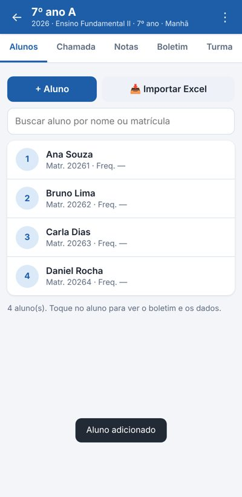
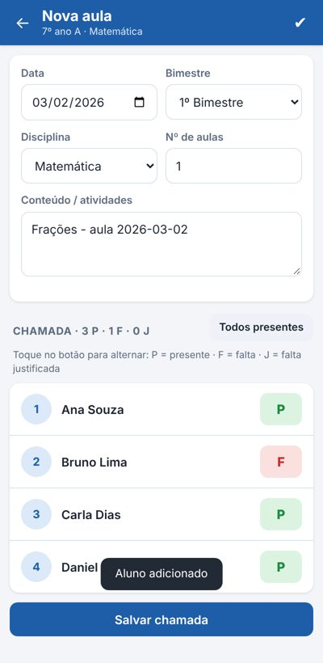
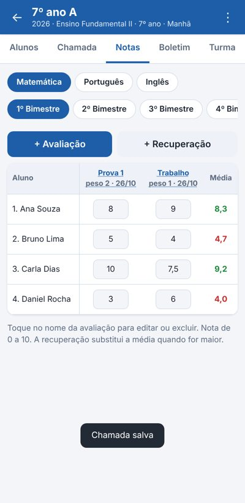
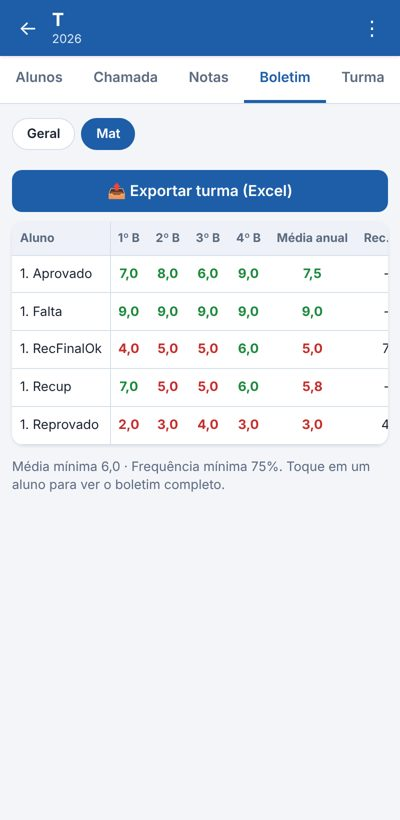
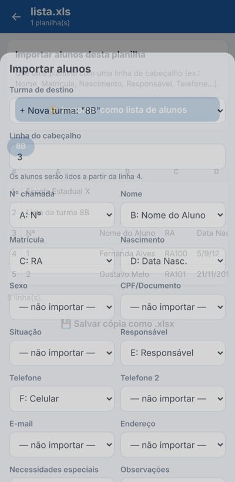

# Diário de Classe (Android)

Aplicativo Android de diário de classe que funciona **100% offline**: turmas, alunos, chamada,
conteúdo das aulas, notas, médias, recuperação, frequência e boletim, com **importação e
exportação de planilhas Excel**.

**APK pronto para instalar:** [`DiarioDeClasse.apk`](DiarioDeClasse.apk) (Android 5.0 ou superior)

| Alunos | Chamada | Notas | Boletim | Importar Excel |
|---|---|---|---|---|
|  |  |  |  |  |

## Funcionalidades

1. **Turmas**: criar, editar, excluir e copiar a turma (com os alunos) para o ano letivo seguinte.
   Cada turma tem ano letivo, curso/nível, série, turno, **idioma**, sala, horário, escola, professor e observações.
2. **Alunos**: nº de chamada, nome, matrícula/RA, data de nascimento, sexo, CPF/documento, situação
   (ativo, transferido, desistente, remanejado, concluído), responsável, telefones, e-mail, endereço,
   necessidades especiais/saúde e observações. Também guarda o histórico de **ocorrências e anotações**
   (elogio, advertência, atestado, contato com o responsável…). Tem busca e renumeração em ordem alfabética.
3. **Disciplinas/matérias** por turma (com carga horária e professor), **aulas por dia** com data,
   bimestre, número de aulas e conteúdo trabalhado.
4. **Chamada**: um toque alterna P (presente), F (falta) e J (falta justificada). O bimestre é
   sugerido automaticamente pela data, conforme o calendário do ano letivo.
5. **Notas**: avaliações com peso por bimestre, recuperação bimestral e recuperação final. Média
   do bimestre, média anual, média final, frequência (%) e **situação** (Aprovado, Recuperação,
   Reprovado, Reprovado por falta, Cursando) são calculadas automaticamente.
6. **Boletim** da turma (por disciplina ou geral) e boletim individual de cada aluno.
7. **Ano letivo**: bimestres, trimestres ou semestres, com datas de início e fim de cada período e dias letivos.
8. **Configurações**: média mínima (padrão 6), frequência mínima (padrão 75%), nota máxima,
   cálculo da média (ponderada, aritmética ou soma), regra da recuperação e se a falta justificada conta como presença.

### Excel (importar e exportar)

- **Ler arquivos externos**: abre `.xlsx`, `.xls` (Excel 97-2003), `.ods` e `.csv`. Mostra o conteúdo de
  cada planilha e permite:
  - **importar uma lista de alunos** de qualquer planilha: o app encontra a linha de cabeçalho e
    associa as colunas sozinho (Nome, Matrícula/RA, Nascimento, Responsável, Telefone…), e você pode ajustar;
  - **importar um diário exportado** por este app (mescla turmas, alunos, aulas, chamada, notas e ocorrências);
  - salvar uma cópia da planilha como `.xlsx`.
- **Exportar para Excel (.xlsx)** uma turma ou tudo. Planilhas geradas: *Boletim*, *Notas &lt;disciplina&gt;*
  e *Freq &lt;disciplina&gt;* (mapas prontos para imprimir), *Turmas*, *Alunos*, *Aulas*, *Chamada*, *Notas*,
  *Ocorrências* e *Configurações*. Também exporta o boletim individual do aluno.
- Planilha-modelo de alunos disponível em Configurações.

> Observação: “.xlc” é o antigo formato de *gráfico* do Excel e não guarda tabelas; o app trabalha
> com os formatos de planilha `.xlsx`/`.xls` (e `.csv`/`.ods`).

### Offline e cópia de segurança

Nenhum dado sai do aparelho e não é preciso internet. Os dados ficam no armazenamento interno do app
(com cópia automática do último estado). Em **Configurações → Salvar backup (.json)** você gera um
arquivo para guardar ou levar para outro aparelho, e restaura em **Restaurar backup**.

## Instalação

1. Copie o `DiarioDeClasse.apk` para o celular (ou baixe pelo GitHub no próprio aparelho).
2. Abra o arquivo e permita “instalar apps de fontes desconhecidas” quando o Android pedir.
3. Se o Play Protect avisar sobre app desconhecido, toque em “Mais detalhes → Instalar mesmo assim”.

## Como compilar

O projeto não depende do Gradle nem do Android Studio. Num Ubuntu/Debian:

```bash
sudo apt install openjdk-17-jdk android-sdk-platform-23 aapt dalvik-exchange zipalign apksigner
./build.sh
```

O `build.sh` compila os recursos (aapt2), o Java (javac), gera o `classes.dex` (dx), alinha e assina o APK.
Na primeira execução ele cria a chave de assinatura em `keystore/` (fora do git). **Guarde essa chave**:
para atualizar o app no celular sem desinstalar, a nova versão precisa ser assinada com a mesma chave.

## Estrutura

```
AndroidManifest.xml
src/br/diario/classe/MainActivity.java   WebView + ponte para salvar dados e abrir/salvar arquivos
assets/index.html, style.css, app.js     interface e regras do diário (offline)
assets/lib/xlsx.full.min.js              SheetJS 0.18.5 (Apache-2.0), leitura e gravação de Excel
res/                                     ícone e nome do app
tools/make_icon.py                       gera os ícones
build.sh                                 compila e assina o APK
```

A interface também roda num navegador comum (abra `assets/index.html`); nesse caso os dados ficam no
`localStorage` e os arquivos são baixados pelo navegador.
